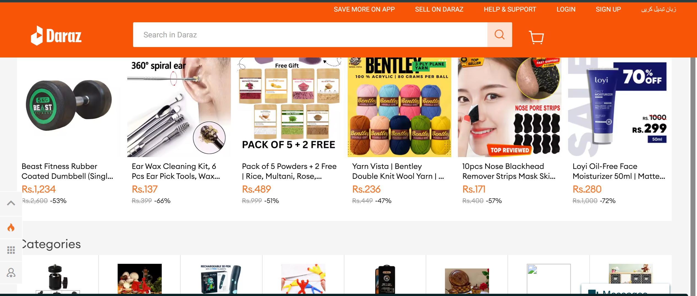

# Assignment 2 - ShopEasy E-commerce Site

## Reference Site

- **Name:** Daraz
- **URL:** https://www.daraz.pk

## What my site copies from the reference site

- A top navigation bar with the site name, links, and a cart button
- A responsive grid of product cards with image, name, price, and an Add to Cart button
- A product detail page with a large image, price, description, and quantity selector
- A footer with columns of links

## Pages

- `index.html` - homepage with 8 product cards
- `product.html` - product detail page
- `styles.css` - custom styles

## Built with

HTML, CSS, and Bootstrap 5 (navbar and grid)